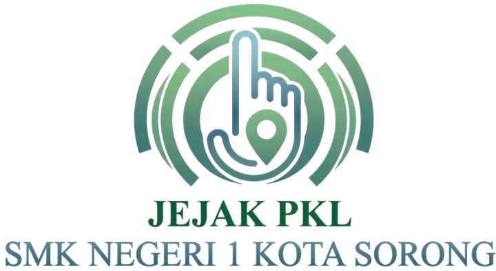

# JEJAK PKL: Rekam Perjalanan Siswa SMK

Aplikasi web untuk mengelola perjalanan siswa selama Praktik Kerja Lapangan (PKL): kehadiran, jurnal refleksi, foto kegiatan, arsip dokumen, pantauan guru, dan cetak dokumen sesuai format sekolah.

**Tim:** [ISI nama tim] · Fitri, Amri, Noval · SMK Negeri 1 Sorong
**Lomba:** Perancangan dan Pengembangan Aplikasi Berbasis Web Berbantuan AI, 2026

**Aplikasi:** https://nightevilesport01-ai.github.io/jejak-pkl/web/
**Video tutorial:** [ISI link YouTube] · **Poster:** [ISI nama berkas]

## Masalah yang diselesaikan
Dari wawancara dengan guru pembimbing PKL dan formulir resmi sekolah:
- Sertifikat, raport, dan lembar penilaian PKL sering hilang, dan siswa tidak tahu di mana menyimpannya.
- Guru membimbing 7 sampai belasan siswa yang sebagian PKL jauh dari sekolah, sehingga sulit memantau kehadiran dan keaktifan mereka.
- Siswa menulis ulang absen dan jurnal ketika menyusun laporan PKL.

## Solusi
Siswa mencatat sekali, lalu datanya dipakai ulang: untuk pantauan guru, perkembangan, arsip, dan dokumen cetak.

**Alur:** Kehadiran → Jurnal refleksi → Foto dan dokumen → Tanggapan guru → Perkembangan → Cetak Daftar Hadir, Daftar Kegiatan Harian, dan Laporan PKL.

## Fitur yang sudah berjalan
**Siswa**
- Login, check-in dan check-out (jam masuk dan pulang dicatat server), izin dan sakit dengan alasan. Jam ditampilkan sesuai zona waktu tempat PKL (WIT, WITA, atau WIB).
- **Jurnal refleksi:** tanggal, judul, unit kerja, apa yang dikerjakan, apa yang dipelajari, yang belum dipahami, bagian paling menarik, bagian paling sulit, tingkat pemahaman, ingin belajar lebih lanjut, perasaan, meneruskan pertanyaan ke guru, dan foto (maksimal 5, dikecilkan otomatis).
- **Bukti & Arsip PKL:** foto kegiatan per tanggal, serta dokumen (sertifikat, raport, lembar penilaian, surat, bukti kegiatan, laporan) dalam bentuk foto atau PDF. Bersifat privat.
- **Perkembangan:** jurnal per minggu, komposisi tingkat pemahaman, daftar yang belum dipahami dan paling sulit, rekap kehadiran.
- **Cetak dokumen:** Daftar Hadir dan Daftar Kegiatan Harian dalam format sekolah, dengan kotak tanda tangan.
- **Kirim kabar ke orang tua:** setelah check-in, check-out, izin, atau sakit, siswa bisa membuka WhatsApp dengan pesan siap kirim. Siswa memilih sendiri kontaknya, dan JEJAK tidak menyimpan nomor orang tua.
- **Portofolio ringkas:** satu halaman A4 berisi tentang saya, capaian, keterampilan, hingga 4 kegiatan unggulan (dipilih dari jurnal, lengkap dengan foto), dan daftar dokumen pendukung, siap dicetak atau disimpan sebagai PDF. Bersifat privat, tanpa tautan publik.
- **Laporan PKL:** mengisi bagian laporan (kata pengantar, Bab I, Bab II, Bab III), menyisipkan foto dan tabel, lalu cetak PDF atau unduh Word (.docx) sesuai format sekolah.

**Guru pembimbing**
- Dashboard siswa bimbingan: hadir hari ini (jam masuk dan pulang), jumlah jurnal 7 hari terakhir, pertanyaan yang belum dijawab.
- Detail siswa: kehadiran, jurnal beserta kotak tanggapan, filter "perlu ditanggapi", foto kegiatan, dokumen (hanya lihat), halaman perkembangan, dan pencatatan Alpa.

**Admin:** akun dibuat lewat dashboard Supabase (tidak ada pendaftaran bebas). Halaman admin saat ini hanya menampilkan jumlah siswa.

## Akun demo
Semua akun di bawah ini hanya akun contoh untuk penjurian, bukan akun asli.

| Peran | Email | Password |
|---|---|---|
| Admin | admin.jejak@example.com | JejakDemo#2026 |
| Guru 1 | guru1.jejak@example.com | JejakDemo#2026 |
| Guru 2 | guru2.jejak@example.com | JejakDemo#2026 |
| Siswa 1 | siswa1.jejak@example.com | JejakDemo#2026 |
| Siswa 2 | siswa2.jejak@example.com | JejakDemo#2026 |

Siswa 1 dibimbing Guru 1, dan Siswa 2 dibimbing Guru 2. Siswa 2 diatur memakai zona waktu WITA untuk memperlihatkan fitur zona waktu.

## Teknologi
- **Tampilan:** HTML, CSS, dan JavaScript murni (tanpa framework), dirancang untuk HP (360 px) dan laptop.
- **Basis data dan login:** Supabase (PostgreSQL, Authentication, Storage, Row Level Security).
- **Hosting:** GitHub Pages.
- **Pustaka dari CDN:** `supabase-js` (koneksi) dan `docx` (unduh Word).

## Keamanan
- **Row Level Security aktif di semua tabel.** Siswa hanya bisa membaca dan mengubah datanya sendiri, guru hanya siswa bimbingannya, dan orang tanpa login tidak bisa mengakses data.
- Halaman dijaga per peran. Siswa yang membuka alamat halaman guru dialihkan kembali.
- Kunci yang dipakai di aplikasi hanya kunci publik (`sb_publishable_`). Kunci rahasia tidak ada di repository.
- Foto dan dokumen disimpan di penyimpanan **privat**, dibuka lewat tautan sementara (1 jam).
- Teks yang diketik pengguna ditampilkan sebagai teks biasa (bukan kode), sehingga aman dari XSS.
- Jam masuk dan pulang dicatat oleh server, dan siswa tidak bisa mengubah baris kehadirannya setelah tercatat.

**Hasil uji:** SQL injection di login, XSS di judul jurnal, siswa membuka halaman guru dan admin, halaman tanpa login, guru membuka siswa guru lain, dan isi `config.js`. Semuanya lolos.

## Struktur repository
- `web/`: seluruh halaman aplikasi.
- `supabase/`: berkas SQL basis data. Jalankan berurutan di SQL Editor Supabase (tab query baru untuk tiap berkas):
  1. `schema-jejak-1.sql`: 6 tabel awal dan RLS aktif
  2. `schema-jejak-2-akun.sql`: nama dan peran akun contoh (setelah akun dibuat di menu Authentication)
  3. `schema-jejak-3-rls.sql`: aturan akses tiap peran
  4. `schema-jejak-4-kehadiran.sql`: jam pulang
  5. `schema-jejak-5-zona-waktu.sql`: zona waktu per siswa
  6. `schema-jejak-6-foto.sql`: penyimpanan foto kegiatan
  7. `schema-jejak-7-dokumen.sql`: arsip dokumen
  8. `schema-jejak-8-dokumen-guru.sql`: guru boleh melihat dokumen
  9. `schema-jejak-9-jadwal.sql`: jadwal kerja dan status libur
  10. `schema-jejak-10-laporan.sql`: isi laporan dan kode program keahlian
  11. `schema-jejak-11-portofolio.sql`: portofolio ringkas
  - `uji-rls-1.sql`: uji cepat aturan akses.

## Menjalankan sendiri
1. Buat project di supabase.com (region Singapore).
2. Buat akun di **Authentication → Users** (centang Auto Confirm User), lalu jalankan berkas SQL di atas sesuai urutan.
3. Buka `web/config.js`, isi `SUPABASE_URL` dan kunci `sb_publishable_` dari project kamu.
4. Unggah folder `web` ke GitHub dan aktifkan GitHub Pages (Settings → Pages → branch `main`).

## Rencana pengembangan
Belum dibuat, dan tidak dihitung sebagai fitur saat ini:
- Tautan portofolio publik dengan persetujuan siswa dan orang tua (opt-in).
- Badge keterampilan dari pembimbing industri (perlu peran dan akun industri).
- Notifikasi kehadiran ke orang tua yang otomatis (WhatsApp Business API atau SMS). Saat ini siswa mengirim kabar sendiri lewat tombol WhatsApp.
- Penanda hari tanpa catatan dan konfirmasi Alpa oleh guru.
- Halaman admin lengkap (kelola siswa dan penempatan PKL).
- Ringkasan dan draf laporan dengan AI, yang tetap diperiksa siswa.

## Tools AI yang digunakan
- **Claude (Anthropic):** membantu merancang PRD, menyusun dan meninjau kode, membuat panduan langkah demi langkah, dan menulis dokumentasi.
- **Canva:** [ISI jika dipakai] untuk poster.
- Semua fitur diuji tim di perangkat sendiri, dengan data contoh (bukan data siswa asli).

## Lisensi dan data
Proyek lomba sekolah. Data di aplikasi demo adalah data contoh.
